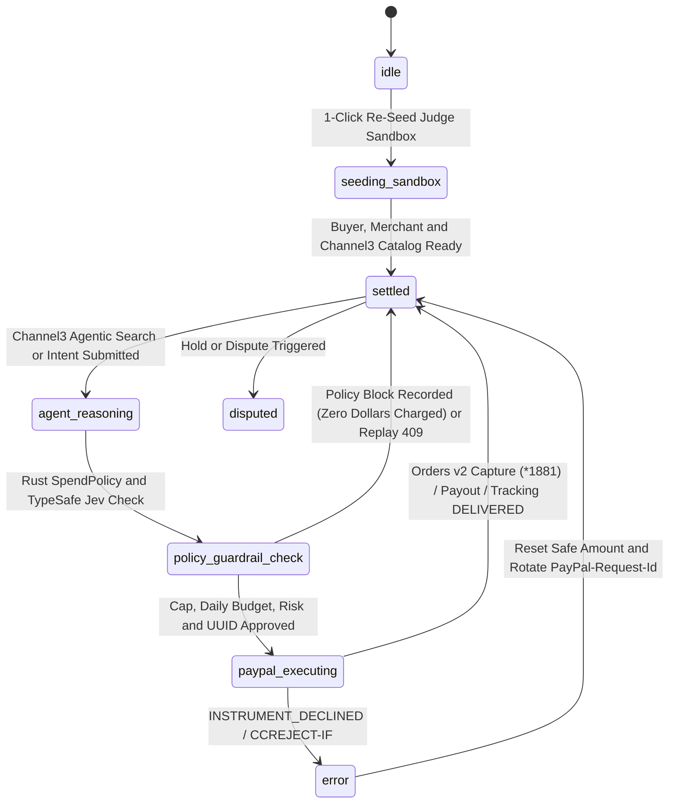

# PayPal Sentinel: Devpost Early Eligibility Review and Final Submission Kit (`project_1`)

## 1. Pre-Submission Gate Checklist

Early Eligibility Review: November 5, 2026. Final Deadline: November 12, 2026 at 12:00 PM PST (November 13, 2026 at 3:00 AM ICT).

1. [x] Meaningful PayPal Sandbox Integration: Live integration with PayPal Developer Platform in Sandbox mode (`https://api-m.sandbox.paypal.com`), covering Orders v2 (`POST /v2/checkout/orders` with `PayPal-Request-Id` UUID and headless ACDC card `4012888888881881` direct capture), Batch Payouts v1 (`POST /v1/payments/payouts`), Invoicing v2, Disputes v1, Subscriptions v1, Shipment Tracking v1 (`POST /v1/shipping/trackers-batch`), Reporting v1 (31-day ISO-8601 window with fractional milliseconds stripped), constant-time HMAC-SHA256 Webhook verification, and `@paypal/agent-toolkit` (`PayPalMCPToolkit`).
2. [x] Meaningful AI Integration: Combines Channel3 Agentic Search (`POST https://api.trychannel3.com/v1/search` with `config.mode = "agentic"`), TypeSafe AI SystemOne (`jev-1.13.0`) Noul probability risk judgment, AG Studio natural-language KPI synthesis, and 10 MCP agent tools (`@paypal/mcp` plus 3 Rust-guarded settlement and discovery bridges).
3. [x] Functional Live Build and Complete Setup Instructions:
   1. [x] Hosted Production Live Demo: Active on Railway at `https://paypal-sentinel-production.up.railway.app` with companion declarative `render.yaml` Blueprint for Render cloud deployment.
   2. [x] 1-Click Judge Sandbox Mode: Built directly into the cockpit so judges can execute positive settlements, replay deduplication blocks, negative `INSTRUMENT_DECLINED` checks, and shipment tracking immediately with zero API key setup.
   3. [x] Complete local build, unit test (`cargo test`), Sandbox harness (`node scripts/verify-paypal-sandbox.mjs`), and Playwright E2E (`npm run test:e2e`) instructions provided in `README.md`.
4. [x] Public Open-Source Repository and Top-Level MIT License:
   1. [x] Root `LICENSE` (`MIT`) committed at the top of the repository so GitHub displays the open-source license badge in the About section (`https://github.com/harrymove-ctrl/paypal-sentinel`).
   2. [x] Zero secrets committed (`.env` and `.env.local` excluded via `.gitignore`; `.env.example` provided).
5. [x] Under-3-Minute Demo Video Ready (Runtime: 2 minutes 44 seconds):
   1. [x] Master Demo Film (Runtime: 2 minutes 44 seconds, 1080p at 30fps): `https://github.com/harrymove-ctrl/paypal-sentinel/releases/download/v1.0.0/paypal-sentinel-hackathon-master.mp4` (strictly under the 3-minute hard ceiling).
   2. [x] Social Launch Video (Runtime: 44 seconds, 1080p at 30fps): `https://github.com/harrymove-ctrl/paypal-sentinel/releases/download/v1.0.0/paypal-sentinel-x-launch.mp4`.

## 2. Devpost Submission Form Fields (`project_1`)

1. Project Name: `PayPal Sentinel: Safe AI Procurement with Rust Spend Guardrails`
2. Elevator Pitch (Under 200 Characters): `Delegate real shopping and vendor payouts to AI without handing LLMs a blank check: Channel3 agentic search, TypeSafe AI risk scoring, deterministic Rust guardrails, and instant PayPal Sandbox settlement.`
3. Hosted Live Demo URL: `https://paypal-sentinel-production.up.railway.app`
4. Public GitHub Repository: `https://github.com/harrymove-ctrl/paypal-sentinel`
5. Public Demo Video Link: `https://github.com/harrymove-ctrl/paypal-sentinel/releases/download/v1.0.0/paypal-sentinel-hackathon-master.mp4`
6. Social Launch Video Link: `https://github.com/harrymove-ctrl/paypal-sentinel/releases/download/v1.0.0/paypal-sentinel-x-launch.mp4`
7. Targeted Prize Categories (Stackable across $69,750 Pool):
   1. [x] Overall 1st / 2nd / 3rd Place ($12,000 / $8,000 / $5,000)
   2. [x] Best Use of PayPal + AI ($5,000)
   3. [x] Best Use of Agentic Commerce ($5,000)
   4. [x] Most Creative ($5,000)
   5. [x] Most Impactful ($5,000)
   6. [x] Best Demo Delivery ($5,000)
   7. [x] Best Use of AG Grid ($5,000 1st / $2,000 2nd / $1,000 3rd)
   8. [x] Best Use of Channel3 ($1,500)
   9. [x] Best Use of APIMatic ($1,000 x3 + 6-month Business Plan)
   10. [x] Best Use of Bryntum ($1,000 x3)
   11. [x] Best Use of Render ($1,000 / $750 / $500 Render Credits)
8. Built With Tags: `paypal`, `paypal-sandbox`, `paypal-agent-toolkit`, `paypal-mcp`, `rust`, `axum`, `tokio`, `nextjs`, `typescript`, `channel3`, `ag-grid`, `bryntum`, `apimatic`, `render`, `railway`, `ai-agents`

## 3. Unified Architecture: Three Pillars, Five Tracks, Twelve Patterns

PayPal Sentinel acts as the All-Concept Flagship Suite unifying three hackathon pillars into one production system:

1. Safe Agentic Shopping and Team Procurement Desk (Original Sentinel Core)
2. Autonomous Milestone Escrow and Multi-Currency Invoicing (PayPal Pact)
3. Multi-Party Revenue, Bounty, and Donation Splitting (PayPal SplitStream)

### Track 1: AI Agents and Automation

1. `a2a_negotiate_settle`: Agent-to-Agent (A2A) Negotiation and Auto-Settlement. Buyer Agent and Merchant Agent negotiate SLA and volume discounts ($320 down to $265) before settling through PayPal Orders v2 with Visa card 1881.
2. `auto_contractor_payout`: Scheduling Assistant Auto-Pays Contractor on Job Complete. Detects verified deliverable and shipment tracking status before triggering an instant PayPal Batch Payout v1.
3. `http402_crawler_paywall`: HTTP 402 and L402 AI Crawler Paywall with Per-Crawl Settlement. Autonomous research agent encounters an HTTP 402 paywall, verifies Rust spend policy, and settles a micro-charge via PayPal Orders v2 to obtain a signed SHA-256 permit receipt.

### Track 2: Money Movement Experiences

4. `receipt_bill_split`: AI Receipt Scanner and Instant Group Dinner Bill Splitter. Parses line items, taxes, and gratuity from dining receipts to generate itemized PayPal Invoicing v2 payment links and QR codes.
5. `phone_instant_send`: Phone Number and Handle Instant Send for Gig Approval Payouts. Dispatches instant contractor payouts via PayPal Payouts v1 using telephone numbers or email handles the moment work is approved.
6. `oss_pr_bounty_payout`: Open-Source Pull Request Bond and Instant Contributor Batch Payout. Solves official PayPal Agent Toolkit issue 107 by providing programmatic Payouts with 30-day `sender_batch_id` deduplication upon merged pull requests.

### Track 3: Business Solutions

7. `multi_currency_invoice`: Multi-Currency Freelancer Invoicing with Pay Later Installments. Issues cross-border invoices in EUR, GBP, or JPY converted to USD with optional 4-installment interest-free PayPal Pay Later terms.
8. `marketplace_split_checkout`: Marketplace Platform with Multi-Seller Automatic Split and Creator Tips. Automatically disburses gross cart checkout into a 10 percent platform commission, 60 percent lead creator share, and 30 percent contributor payout.
9. `dispute_evidence_shield`: Seller Chargeback and SNAD Dispute Evidence Shield. Solves official PayPal Agent Toolkit issues 109 and 118 by automatically submitting SHA-256 Buyer Intent Mandates and carrier delivery confirmations to `POST /v1/customer/disputes/{id}/provide-evidence`.

### Track 4: Consumer Experiences

10. `consumer_budget_categorizer`: AI Auto-Budget Categorizer and Duplicate Subscription Shield. Audits recurring billing against PayPal Subscriptions v1 and Transactions Reporting v1 to identify redundant SaaS subscriptions and unauthorized charges.
11. `chat_request_money`: Embedded In-Chat Request Money Card with 1-Tap Settlement. Generates interactive payment cards inside collaboration threads backed by PayPal Payment Links and Orders v2.

### Track 5: Social Impact Ideas

12. `social_impact_multi_cause`: Multi-Cause Split Donation and Neighborhood Solar Co-op Pool. Allows donors to split contributions across neighborhood solar grids (40 percent), underbanked microloans (35 percent), and ocean cleanup (25 percent) with accessible WCAG AAA flows and automated field partner disbursement.

## 4. Explicit State Machine (`stateDiagram-v2`)

## 5. Judge Testing and PayPal Sandbox Instructions

1. Zero-Setup 1-Click Judge Sandbox Mode:
   Open the hosted live production URL (`https://paypal-sentinel-production.up.railway.app`) or local cockpit (`http://localhost:4100`). Click "1-Click Re-Seed Judge Sandbox" in the top-right card to initialize pre-funded Sandbox Buyer and Merchant accounts, retail catalog items, and Bryntum fulfillment milestones with zero API keys required.
2. Test Flow 1: Channel3 Agentic Discovery and PayPal Orders v2 Headless Capture:
   In the Command Split tab, search `monitor` in Channel3 Product Search. Select the UltraSharp 32 4K USB-C Hub Monitor ($445) and click "1-Click Card *1881 Capture". Observe the live Rust Guardrail trace executing Channel3 SKU verification, TypeSafe AI Jev probability scoring, and completed PayPal Orders v2 capture via Visa 1881.
3. Test Flow 2: Adversarial Red-Team Guardrails (Overspend, Decline, and Replay Protection):
   Click "Simulate Overspend Guardrail ($850)" to verify that the Rust engine blocks the charge against the $500 single-order limit with `SINGLE_ORDER_CAP_EXCEEDED` and zero dollars charged. Click "Simulate INSTRUMENT_DECLINED" to verify negative decline handling (`CCREJECT-IF`). Open QA mode (`?debug=1`) to verify HTTP 409 replay protection and constant-time HMAC-SHA256 webhook verification.
4. Test Flow 3: AG Studio Grid and Bryntum Shipment Resource Scheduler:
   Switch to AG Studio Grid (`AgGridReact v36`) to test natural-language Studio Agent queries (Merchant Spend vs Blocked, Risk and Dispute Anomaly, Card 1881 Captures) and CSV export. Switch to Bryntum Scheduler, zoom timelines (7, 14, 30 days), and click "DELIVERED" on Milestone ms-02 to attach a PayPal Shipment Tracker (`POST /v1/shipping/trackers-batch`) and advance SLA progress to 100 percent.
5. Test Flow 4: Found Inspiration Studio (12 Live Patterns):
   Open the Inspiration Studio tab to select and run any of the 12 live executable patterns across all 5 Devpost Tracks with instant tactile breakdowns, PayPal Sandbox settlements, and receipt generation.

## 6. Devpost Story and Technical Write-Up (Copy-Paste Ready)

### Inspiration

Operations managers, engineering leads, freelance collectives, and everyday consumers want AI agents to search across retailers, compare hardware or service quotes, and complete transactions automatically. In practice, nobody trusts an autonomous LLM with raw credit card numbers or banking credentials because models hallucinate quantities, retry failed tool calls into duplicate charges, deal with unverified counterparties, or blow past budgets.

We built PayPal Sentinel to eliminate the trust barrier in agentic commerce by cleanly decoupling flexible AI discovery and reasoning from deterministic Rust financial guardrails on top of the PayPal Developer Platform.

### What It Does

PayPal Sentinel is an autonomous shopping, procurement, and settlement desk. AI agents discover real retail products through Channel3, evaluate counterparty risk with TypeSafe AI (`jev-1.13.0`), submit payment intents through a deterministic Rust (`axum` + `tokio`) Spend-Policy Guardrail Engine, and settle transactions in the PayPal Sandbox using Orders v2, Batch Payouts v1, Invoicing v2, Disputes v1, Subscriptions v1, and Shipment Tracking v1.

The application serves as an All-Concept Suite that unifies three core workflows: Safe Procurement, Milestone Escrow (PayPal Pact), and Multi-Party Revenue Splitting (PayPal SplitStream) across 12 live executable patterns covering every official Devpost track. Operators monitor live spend vs blocked attempts inside an AG Studio (`AgGridReact v36`) telemetry grid and supervise vendor delivery timelines on a Bryntum Resource Scheduler wired to live PayPal Trackers.

### How We Built It (PayPal Developer Platform, AI, and Rust)

1. PayPal Developer Platform and AI Toolkit (`@paypal/agent-toolkit` and `@paypal/mcp`):
   Our Rust backend implements OAuth 2.0 token caching with automatic 60-second pre-expiry refresh and 401 retry, deterministic RFC 4122 UUID `PayPal-Request-Id` idempotency headers, server-to-server Orders v2 direct card capture (`POST /v2/checkout/orders` with Sandbox ACDC Visa `4012888888881881`), negative decline testing (`PayPal-Mock-Response: INSTRUMENT_DECLINED` and `CCREJECT-IF`), Shipment Tracking (`POST /v1/shipping/trackers-batch`), and Reporting (`GET /v1/reporting/transactions` with fractional milliseconds stripped for PayPal 31-day compliance). Furthermore, we patch real gaps in official PayPal tooling by introducing Rust-guarded Batch Payouts (fixing `@paypal/agent-toolkit` issue 107) and automated Dispute Evidence submission (fixing `@paypal/agent-toolkit` issues 109 and 118).
2. High-Assurance Rust Guardrail Engine (`backend-rust/`):
   Built with `axum`, `tokio`, `reqwest`, `hmac`, `sha2`, and `thiserror` with zero `.unwrap()` calls on request paths. Before any network call reaches PayPal, Rust enforces per-order caps ($500 default), daily treasury limits ($2,500 default), counterparty risk ceilings (less than or equal to 35 out of 100), replay deduplication (`409 CONFLICT`), and constant-time HMAC-SHA256 webhook verification. Network calls execute strictly outside `RwLock` critical sections.
3. Sponsor Integrations Across the Pipeline:
   1. Channel3: Queries `POST https://api.trychannel3.com/v1/search` in agentic mode, injecting active Rust spend ceilings into search filters and normalizing nested retailer offer prices and inventory availability.
   2. AG Grid v36 and AG Studio: Powers the enterprise financial ledger with custom cell renderers, quick filtering, CSV export, and a natural-language Studio KPI Agent synthesizing spend telemetry.
   3. Bryntum Scheduler: Renders zoomable vendor procurement lanes where milestone completions invoke PayPal Shipment Trackers live.
   4. APIMatic Context Plugin: Enforces typed OpenAPI 3.1 contracts across Orders v2, Trackers v1, and Payouts v1.
   5. Render Blueprint and Railway Production: Deployed live on Railway with companion `render.yaml` Blueprint for Render cloud infrastructure.

### Challenges We Ran Into and What We Learned

1. Headless End-to-End PayPal Sandbox Testing Without Browser Walls:
   Standard Orders v2 creation stops at `CREATED` awaiting a buyer login popup. By combining US Sandbox ACDC `payment_source.card` (`4012888888881881`) with deterministic `PayPal-Request-Id` UUID derivation and a 1-Click Judge Sandbox fallback, automated CI suites and hackathon judges can verify `COMPLETED` captures and negative decline handling with zero manual friction.
2. Bridging Tooling Gaps in `@paypal/agent-toolkit`:
   The official toolkit lacked programmatic Payouts capabilities (Issue 107) and only offered surrender-only `accept_dispute_claim` actions for disputes (Issues 109 and 118). We authored custom Rust-guarded tools (`sentinel_batch_payout` with 30-day `sender_batch_id` deduplication and `sentinel_dispute_evidence_shield` with cryptographic intent proof) to deliver complete end-to-end functionality.
3. Timestamp Normalization and Channel3 Offer Formatting:
   PayPal's `/v1/reporting/transactions` rejects ISO-8601 timestamps containing milliseconds, while Channel3 nests live prices inside `offers[0].price.price`. Encoding these contracts into strict Rust domain types and unit tests prevented subtle runtime failures.

### What Is Next

We plan to expand PayPal Sentinel with multi-signatory Slack approval webhooks for corporate procurement, automated seller dispute defense packaging carrier delivery geofencing data, and multi-tenant virtual card provisioning for autonomous enterprise agent fleets.
